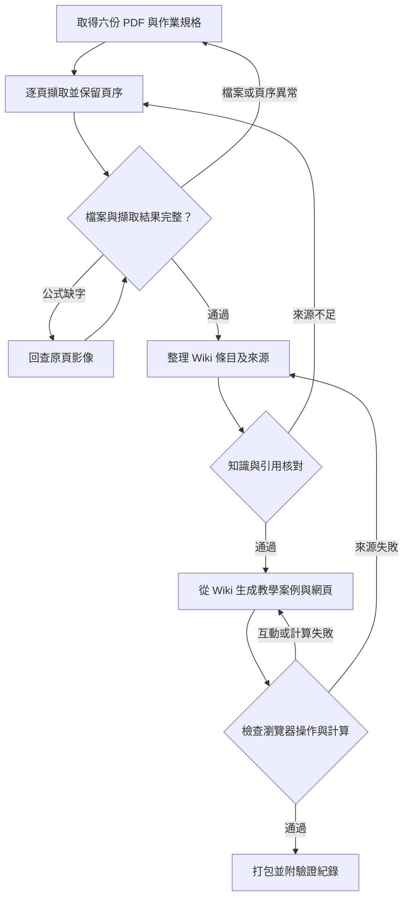

# Decision Science Wiki｜從機率到最佳決策

以莊皓鈞老師的 Decision Science Lecture 1–6 為來源，把隨機模擬、決策樹、機率分配與最佳買賣決策整理成初學者可查詢的知識庫，並用鮮食進貨的問題串起十頁互動教學。

## 開啟成果

- [知識 Wiki](docs/index.html)，六份講義、100 頁逐頁擷取、17 則綜整條目。
- [互動教學簡報](docs/slides.html)，可換頁、抽樣、拖曳參數、試算與答題。每張投影片都有可點擊的 Wiki 依據。
- [流程與反思](docs/workflow.html)及[實跑紀錄](QA.md)。

解壓縮後，保留完整資料夾結構，使用瀏覽器開啟 `docs/index.html`。也可以在專案資料夾執行 `python3 -m http.server 8000 --bind 127.0.0.1 --directory docs`，再開啟 `http://127.0.0.1:8000/`。

此作業採用 LLM 離線整理知識的做法。瀏覽器根據中英關鍵詞、部分常見問法及講義篩選找出有來源的 Wiki 條目。網站執行時不需要模型 API、帳號或網路。查詢範圍以已整理的條目為準。頁碼從 PDF 封面開始，與講義文字提到的教科書頁碼分開。原 PDF 與逐頁全文保留在本機工作階段，公開目錄只放改寫條目、來源頁碼及檔案識別資訊。

## Loop / Graph

實際重試發生在擷取、公式核對與 Wiki 互動。來源不明時先回 PDF 查證，只有 UI 行為出錯時才回程式修正與重測。

##反思

1. **哪一個節點最常出錯？**  
   最容易出錯的是「PDF文字擷取與來源核對」。例如 Lecture 4 的 PDF 第 11 頁，相關係數公式在擷取後只留下分子，漏掉分母。回看 PDF 原頁後，才確認分母是兩個標準差的乘積。

2. **把檢查往前移到哪一步？**  
   我把公式檢查移到「PDF 擷取完成後、寫入 Wiki 前」。遇到分數、上下標或特殊符號時，先和 PDF 原頁比對，再把公式寫進 Wiki。

3. **有修改 workflow / graph 嗎？為什麼？**  
   在擷取後加了一個檢查分支，發現公式缺字時會回查 PDF 原頁、補齊並重新核對，確認後才繼續整理 Wiki。
